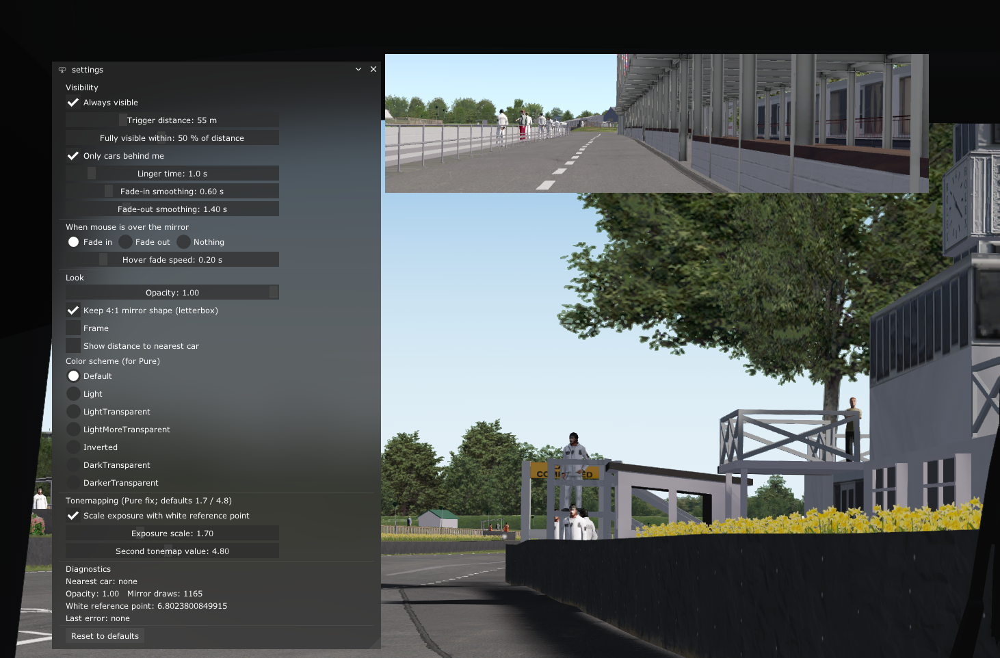

# AC-Proximity-Mirror

A Lua app for Assetto Corsa that shows a virtual rear-view mirror only when opponent cars are within a configurable distance.

This project started as a simple personal feature request: I wanted a rear-view mirror that appears only when nearby cars are close enough to matter, instead of staying visible all the time.

This project takes no credit for the original idea or underlying implementation; it was developed with AI assistance. The goal here is to provide a working, configurable mirror app and to acknowledge the people whose work made it possible.

## Screenshot

> Place a screenshot named `screenshot.png` in the repository root to display it here.

## Features

- Shows the game's virtual rear-view mirror only when nearby opponents are within range
- Smooth fade-in and fade-out behavior
- Distance-based activation with configurable trigger thresholds
- Optional rear-only detection (ignoring cars in front of you)
- Hover and visibility controls
- Adjustable mirror appearance, framing, opacity, and color scheme
- Built-in settings window for tuning behavior
- Includes a tonemapping workaround for the washed-out rendering issue seen with Pure

## Why this exists

The motivation for this app was simple: I wanted a rear-view mirror that would only appear when cars were close enough to matter, without keeping the mirror visible at all times.

## Credits

- Special thanks to the creator of Pure for identifying the washed-out render bug and the tonemapping fix used here.
- This project builds on the work from the AC Virtual Mirror in-game app by @piereligio and its creator: https://github.com/piereligio/AC-Virtual-Mirror-ingame-app
- The underlying mirror rendering logic is inspired by and adapted from that reference project.

## Installation

This app is designed to be installed in the Assetto Corsa Lua app folder.

1. Download or clone this repository.
2. Copy the entire folder into your Assetto Corsa install at:
   `Assetto Corsa/apps/lua/`
3. The app should exist in a structure like:
   `Assetto Corsa/apps/lua/AC-Proximity-Mirror/`
4. Make sure the folder contains the required files:
   - `ProximityMirror.lua`
   - `manifest.ini`
   - `icon.png`
5. Start Assetto Corsa and enable the app through your Lua app manager / CSP app list if required.
6. Open the mirror window and adjust the settings to your preference.

If you are using Custom Shaders Patch (CSP), this app is intended to be loaded as a Lua app in the standard `apps/lua` directory.

## Configuration

The app exposes several settings via the settings UI, including:

- trigger distance
- fade-in / fade-out smoothing
- linger time after cars leave range
- rear-only filtering
- hover behavior
- opacity and frame options
- color scheme
- tonemapping values for Pure

## Notes

This project is intentionally lightweight and focused on the core behavior: a mirror that appears only when nearby opponents are close enough to matter.

## License

This project does not currently include a license file. If you plan to redistribute or modify it, please confirm the licensing status of the underlying referenced project and any assets before publishing modified builds.
